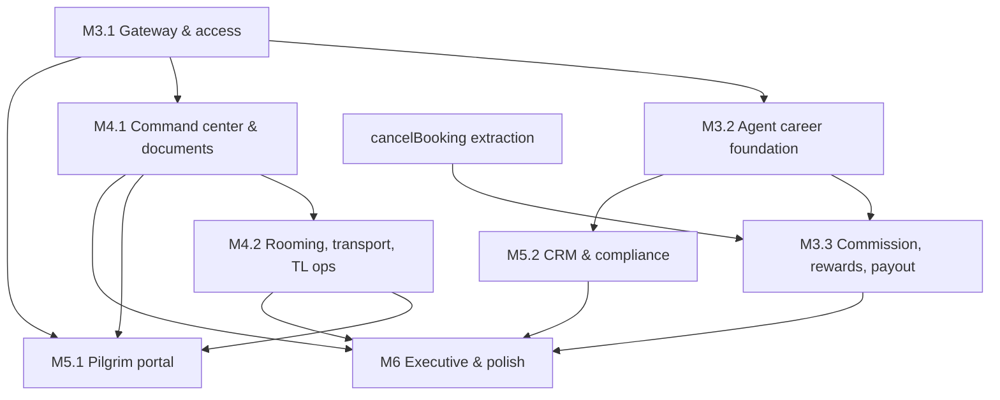

# Hasta Travel Workspace V2 — Architecture (M3.0)

> Target architecture for turning the single-persona admin showcase into a role-based Umrah & Haji Khusus operations demo. Planning only — no source changes in M3.0, no new dependencies proposed.

Related: [Audit](HASTA_V2_REPOSITORY_AUDIT.md) · [Role matrix](HASTA_V2_ROLE_MATRIX.md) · [Data contracts](HASTA_V2_DATA_CONTRACTS.md) · [Roadmap](HASTA_V2_ROADMAP.md)

---

## 1. Principles

1. **Extend, don't fork.** One `DemoState`, one `DemoProvider`, one `transact`, one PDF renderer, one UI kit. Portals are new *views* over the same data, not copies of modules.
2. **Domain logic lives in `lib/admin/*` as pure functions** that take `DemoState` and throw readable errors — like `model.ts`, `costing.ts`, `inventory.ts` today. Components call them inside `transact`. Logic currently inline in components (booking cancellation, agent approval) moves into `lib` before it is extended.
3. **Ledgers are append-only, snapshots are immutable.** Reuse the inventory pattern (`assertInventoryHistory` + `validateInventory`) for commission, payouts, document events, incidents.
4. **Derived over stored.** Readiness, manifests, metrics, risks and executive figures are selectors. Only facts (events, decisions, snapshots) are stored.
5. **Demo honesty.** Every simulation is labelled; no real auth, payment, messaging, airline or government integration is introduced.
6. **Backward compatibility first.** Existing URLs, storage key, saved workspaces, PDFs and tests keep working; migrations run before validation.

## 2. Current vs target

```mermaid
flowchart LR
  subgraph Today
    L[/admin/login credential form/] --> C1[(cookie hasta_admin_session path=/admin)]
    C1 --> W[(workspace) layout: requireSession]
    W --> S[Shell: one sidebar, persona Ahmad]
    S --> A[AdminScreen dispatcher → 18 modules]
    A --> DS[(DemoProvider ↔ localStorage v2)]
  end
  subgraph Target
    G[/admin/login = Pilih Akses Demo/] -->|enterDemo role,persona| C2[(cookie hasta_demo_session path=/ · role+persona)]
    C2 --> WA[admin layout: requireSession + staff role]
    C2 --> WP[portal layout: requireSession + portal role]
    WA --> SA[Shell filtered by role]
    SA --> A2[AdminScreen + access guard]
    WP --> SP[PortalShell mobile, bottom tabs]
    SP --> P2[PortalScreen dispatcher]
    A2 --> DS2[(DemoProvider actor=persona ↔ localStorage v3+ via migrations)]
    P2 --> DS2
  end
```

## 3. Demo gateway and session

### 3.1 Server side

| Piece | Change |
|---|---|
| `lib/admin/session-token.ts` | `signSession(session, secret)` / `readSession(token, secret)` for v2 tokens `hasta-demo.v2.<ROLE>.<persona>.<expires>.<hmac>`; keep accepting the legacy owner token (→ `SUPERADMIN`/`USR-1`). Existing forgery/expiry tests extended, not replaced. |
| `lib/admin/auth.ts` | `getSession(): DemoSession \| null`; `requireSession(scope?: "staff" \| "portal")` redirects to gateway or the role home; `createSession(role, persona)`; `deleteSession()` clears **both** the new cookie and the legacy `/admin`-path cookie. |
| Cookie | New name `hasta_demo_session`, `path: "/"` (portals live outside `/admin`), `httpOnly`, `sameSite=lax`, `secure` in production, 8 h session. Using a new name avoids the browser sending a stale legacy `/admin`-path cookie with higher precedence. |
| `app/admin/actions.ts` | `enterDemo(formData)` validates `role ∈ roleIds` and persona format, creates the session, redirects to `RoleDefinition.home`. `login()` is removed (or kept temporarily as an alias that enters as Superadmin — decision D1). `logout()` kept. |
| Secret | Unchanged: `ADMIN_SESSION_SECRET` still required in production (signing prevents trivially forged role cookies from producing broken states; it is not "authentication"). |
| Route guards | `app/admin/(workspace)/layout.tsx` → `requireSession("staff")`; `[...path]/page.tsx` → `canAccessRoute(role, slug)`; new `app/portal/layout.tsx` → `requireSession("portal")`. No `proxy.ts` needed; layouts already gate access and Next 16 docs position Proxy for optimistic checks only. |

### 3.2 Gateway UI (`components/admin/DemoGateway.tsx`)

- Reuses the login page's split layout (`.admin-login`, `.login-story`) and brand assets.
- Heading "Pilih Akses Demo", 8 role cards (icon, role, one-line "Anda akan melihat…", device hint "Optimal di ponsel" for portal roles).
- Cards for Agent/Pilgrim/Tour Leader expose a persona selector; options are read from `localStorage` on the client (falls back to fixture defaults when storage is empty).
- Persistent notice: "Akses demo tanpa kata sandi. Bukan sistem keamanan produksi. Seluruh data fiktif dan tersimpan di browser ini."
- Secondary actions: "Reset data demo" (confirm dialog), "← Kembali ke website".
- `?switch=1` shows the current role and "Lanjutkan sebagai {role}".

### 3.3 Client side

- `DemoProvider` gains `actor: { id, name, role }` (passed from the server layout) — `transact` writes it into `Activity.user` instead of `"Ahmad"`; inventory `operatorId` uses `actor.id` when it is a staff id (must exist in `users`, already validated).
- `useAccess()` hook: `can(permission)`, `scope` selectors; components hide/disable actions accordingly. `transact` accepts an optional `permission` argument and refuses (toast) if the role lacks it — keeps demo stories consistent even if a button is reached by URL.

## 4. Route and component architecture

```
app/
├─ admin/
│  ├─ login/page.tsx               → <DemoGateway/> (redirects if session)
│  ├─ actions.ts                   enterDemo, logout
│  └─ (workspace)/
│     ├─ layout.tsx                requireSession("staff") → DemoProvider(actor) → Shell(session)
│     └─ [...path]/page.tsx        whitelist + canAccessRoute → AdminScreen | AccessDenied
└─ portal/
   ├─ layout.tsx                   requireSession("portal") → DemoProvider(actor) → PortalShell(session)
   └─ [...path]/page.tsx           validates first segment = session portal (agen|tour-leader|jamaah) → PortalScreen
components/
├─ admin/ (existing modules; minimal edits: guards, read-only props)
│  ├─ Shell.tsx                    nav = navigationFor(role); profile shows persona; "Ganti akses demo"
│  ├─ AccessDenied.tsx             new
│  ├─ DemoGateway.tsx              new
│  └─ dashboards/                  OwnerDashboard, SalesDashboard, FinanceDashboard, OpsDashboard (Dashboard.tsx stays = Superadmin)
└─ portal/
   ├─ PortalShell.tsx              top bar + bottom tabs + demo pill
   ├─ PortalScreen.tsx             dispatcher (like AdminScreen)
   ├─ ui.tsx                       ListCard, KeyValue, StatusTimeline, StickyAction, Sheet (built from admin ui tokens)
   ├─ agent/*  tour-leader/*  pilgrim/*
content/admin/roles.ts             RoleDefinition[], permission matrix, portal tabs
lib/admin/
├─ access.ts                       can, canAccessRoute, navigationFor (pure; unit-tested)
├─ scopes.ts                       visibleBookings(state, session), maskPhone, pilgrimView…
├─ migrations.ts                   ordered migration registry
├─ clock.ts                        demoNow()
├─ booking.ts                      cancelBooking (extracted from Finance.tsx), reattributeBooking
├─ agents.ts                       hierarchy, codes, attribution
├─ career.ts                       metrics, qualification, snapshots
├─ commission.ts                   policies, reconcileCommissions, validateCommissions
├─ payouts.ts                      prepare/approve/pay/void, rewards
├─ readiness.ts                    departureReadiness (rules + blockers); model.readiness() delegates
└─ operations.ts                   vehicles, TL assignment, attendance, incidents
```

Why a catch-all for `/portal`: it mirrors the proven `AdminScreen` dispatch, keeps one guard point, and lets each role's screens be lazy-loaded. Portal pages are client components (data lives in the browser), so per-file routes would add no server benefit.

Reused components in portals: `PaymentHistory` (new `readOnly` prop removes Verify), `FinancialDocuments` (unchanged), `HandoverReceipt` (unchanged), `DocumentChecklist` (new `mode: "staff" | "self"`; self = upload only), `Badge`, `Progress`, `Modal`, `Empty`, `Fields`.

## 5. Booking lifecycle hooks (refactor prerequisite)

`cancelBooking(state, bookingId, { reason, actor, refundDate })` replaces `Finance.tsx:29` and becomes the single place that:

1. sets `Batal` and records reason/actor/date (optional new fields on Booking);
2. marks verified payments `Dikembalikan`; pending payments also `Dikembalikan` (current behaviour, unchanged for compatibility; a distinct "Dibatalkan" status is a later decision);
3. releases rooms (both hotels), vehicle seats (M4.2) and remaining kit reservations (`releaseAllocation` when remaining > 0);
4. marks the linked lead `Lost`;
5. calls `reconcileCommissions` (M3.3) to append reversals.

Other trigger points that call `reconcileCommissions`: `verifyPayment`, departure status change to `Berangkat` (trigger `DEPARTED`), `reattributeBooking`. Reconciliation is idempotent, so calling it more often than needed is safe; a "Sinkronkan komisi" button exists for demos.

## 6. Agent career & network specification

### 6.1 Concepts kept separate

| Concern | Module | Stores | Never does |
|---|---|---|---|
| Attribution | `agents.ts` | `Booking.attribution` | compute money or levels |
| Hierarchy | `agents.ts` | `Agent.parentId`, `AgentHierarchyEvent` | rewrite past snapshots |
| Career qualification | `career.ts` | `CareerSnapshot` (locked) | compute commission |
| Commission | `commission.ts` | `CommissionLedgerEntry` | change levels |
| Rewards | `payouts.ts` | `RewardProgram`, `RewardAchievement` (+ BONUS entries) | count bookings itself — reads locked snapshots |
| Payout | `payouts.ts` | `Payout` | alter entry amounts |

### 6.2 Attribution

- Sources: referral code on a lead (agent portal or staff entry), manual selection on booking, migration from `jamaah.agentId`.
- `convertLead` copies the lead's agent into the new jamaah's default `agentId` **and** the booking attribution (fixes the current loss).
- Attribution **locks** when the first payment of the booking is verified; lock captures `uplineSnapshot` and `levelSnapshot`. Later hierarchy moves never change who earns overrides on locked bookings.
- Changing a locked attribution = `reattributeBooking` (Owner/Superadmin, reason required) → reversal of old entries + new entries under the new agent.
- Optional public-site referral (decision D9): `/paket-umroh/<slug>?ref=CODE` appends "Kode referensi: CODE" to the existing WhatsApp message (`lib/whatsapp.ts`). No backend capture.

### 6.3 Hierarchy

- Forest via `parentId`; `moveAgent` validates no cycle and max depth, appends an `AgentHierarchyEvent`.
- Team metrics use the tree **as of the qualifying event date**, reconstructed from hierarchy events (simple because events are few); overrides use the locked `uplineSnapshot`.
- Network tree UI: indented list with expand/collapse (no chart dependency), showing level badge, personal/team pilgrims for the selected period.

### 6.4 Qualification

1. `qualifyingBookings(state, ruleSet, period)` → bookings attributed to an agent whose qualifying event date (e.g. date of the verified payment that brought balance to 0) falls in the period and that are not cancelled.
2. `careerProgress(state, agentId, period)` → metrics (personal; team = downline up to `teamDepth`, excluding personal; active directs) and the highest level whose requirements hold for `periodsRequired` consecutive periods.
3. `lockCareerPeriod(state, period, actor)` → one `CareerSnapshot` per agent with the exact `bookingIds`; updates `Agent.levelId` (and legacy `level` label) only if `levelAfterId` rank is higher (or lower with `AFTER_MISSED_PERIODS`).
4. Cancellations after lock: never edit the snapshot; with `ADJUST_NEXT_PERIOD` they appear as negative `adjustments` in the next period's metrics.

### 6.5 Commission calculation

`reconcileCommissions(state, today)`:

```
for each booking with attribution.agentId:
  if booking.status == "Aktif" and trigger(policy) met on triggerDate:
     policy = active version for booking.productType at triggerDate
     ensure PERSONAL entry (key PERSONAL:<booking>:<policy@v>)
     for tier in policy.overrides: ancestor = uplineSnapshot[tier.depth-1]
        if ancestor exists, ACTIVE, rank ≥ tier.minLevelRank: ensure OVERRIDE entry
  if booking.status == "Batal" or attribution superseded:
     for each entry of booking without REVERSAL: append REVERSAL (key REVERSAL:<entry>)
```

- Amounts come from `basis`: flat, or `round_half_up(contract × bps / 10000)` with optional cap, computed with `BigInt` like `costing.ts`.
- Rate precedence: `useAgentFlatOverride && agent.commission` → `personalByLevel[levelSnapshot]` → `personal`.
- Policies are versioned; editing an ACTIVE policy creates a new version effective from a date. Past entries keep their `policyVersion`.

### 6.6 Avoiding double counting and duplicate payout

| Risk | Control |
|---|---|
| Same booking earns twice | Unique idempotency `key`; reconcile only appends missing keys |
| Policy edited after earning | Version in key; entries never recalculated |
| Booking counted in two periods | Snapshot stores `bookingIds`; qualifying date is single-valued |
| Booking counted twice in a team | Forest (single parent); each ancestor counts a booking once |
| Personal + team overlap | Team metrics exclude personal by definition |
| Same reward twice | `oncePerAgent` per programme period, unique `(programId, agentId, periodId)` |
| Entry in two payouts | `payoutId` monotonic + validation "one non-void payout per entry" |
| Paying a reversed entry | Payout builder nets reversals; reversed pairs that are both unpaid are excluded |
| Paid then refunded | REVERSAL deducted from next payout (`NET_AGAINST_FUTURE`) or written off by approved ADJUSTMENT |
| Legacy agent `status` | Frozen after migration; not used for totals |

Worked example (fixture policy): Coordinator A ← Senior B ← Agent C. C's pilgrim pays in full on 2026-10-05.
→ `PERSONAL C +1.000.000`, `OVERRIDE d1 B +250.000`, `OVERRIDE d2 A +100.000` (A rank 3 ≥ 3).
Reconcile again → no change. Q4 lock: C personal +1, B team +1, A team +1.
Finance pays C in payout P1. Booking cancelled on 2026-11-02 → `REVERSAL C −1.000.000`, `B −250.000`, `A −100.000`. B and A were unpaid → their pairs net to zero and are excluded. C's reversal is deducted from C's next payout. Q4 metrics (if not yet locked) drop the booking; if locked, Q1 shows an adjustment.

### 6.7 Approval and simulated payout

`preparePayout(agentId, upTo)` (Finance) → DRAFT with payable entries + outstanding negatives → `approvePayout` (Owner) → `markPayoutPaid(reference)` (Finance, simulated, "Tidak ada dana dikirim") → payout slip PDF (new `kind: "payout"` on `renderFinancialPDF`). `voidPayout` from DRAFT/APPROVED releases entries.

### 6.8 Agent portal and admin analytics

- Portal: own referral code + share link, own pilgrims (masked), commission ledger with derived states, payouts + slip, career progress with gap-to-next-level, downline tree, reward progress.
- Admin: agent list with level/code/upline, network tree, level distribution, period leaderboard (personal & team), commission liability (payable, in payout, paid, reversed), policy and reward editors, planned (HPP "Komisi agen") vs accrued commission per departure.

## 7. DemoStore, persistence and migrations

- `decodeDemo`: parse → `runMigrations(data.version → CURRENT)` → `sameShape` → referential validation (existing) → new validators (`validateAgents`, `validateCommissions`, `validateOperations`). Unknown future versions keep failing with the existing reset message.
- `encodeDemo` writes the current version.
- Each migration: pure, deterministic, idempotent, unit-tested from a frozen JSON fixture of the previous version (store fixtures under `tests/fixtures/`).
- `transact` additions: actor injection, optional permission check, `assertLedgerHistory(before, after)` for commission/payout/document/incident append-only rules.
- Size: ledgers add a few hundred records — well within the 10 MB guard. Stop using `JSON.stringify(state)` as a React key in `FinancialDocuments`; key on `resetVersion` + relevant record ids.
- Role switch never calls `reset`; the session cookie and `DemoState` are independent.

## 8. Operational expansion — dependencies and gaps

### A. Departure Command Center
- **Builds on:** `readiness`, `manifestReady`, `kitReady`, `latestCosting`, Rooming, Manasik, Inventory, Departures detail.
- **Gaps:** equal-weight percentage, manual booleans duplicating derived facts, hard-coded TL/muthawwif, no blockers/deadlines, Hajj excluded.
- **Design:** `departureReadiness(state, id, today)` returns `{ percent, checks, blockers[] }` where rules carry severity and deadline (e.g. passport < 180 days = BLOCKER; visa not approved T-14 = BLOCKER; balance due T-30 = WARNING; room/bus unassigned T-7 = WARNING; no TL assigned = BLOCKER; kit not handed over T-3 = WARNING). `readiness()` keeps its output shape for existing callers. The detail route gains tabs (Ringkasan, Blocker, Manifest, Dokumen, Kamar & Bus, Tim, Insiden, Keuangan). Manual checks remain for things without data (Hotel, Asuransi).

### B. Document & Visa Tracking
- **Builds on:** `DocumentChecklist`, `VisaPanel`, `Documents.tsx`, batch actions.
- **Gaps:** no audit trail, no rejection reason, expiry only for passport, fixed requirement list, visa per person.
- **Design:** `DocumentEvent` audit, `DocumentRequirement` rules (fixture = current 8 docs so numbers stay stable), expiry warnings (passport vs departure + 180 days; visa expiry vs return date), `VisaApplication` per booking with history; `Jamaah.visa*` mirrored for compatibility.

### C. Rooming & Transport
- **Builds on:** `Room`, `assignRoom`, `autoAssign`, family-separation warning, transport screen.
- **Gaps:** booking room type unchecked, global `jamaah.bus`, hard-coded flights/driver/capacity, no return flight.
- **Design:** `Vehicle` per departure mirroring the `Room` allocation pattern (`assignVehicle`, `autoAssignVehicles`), `FlightSegment[]`, capacity and gender/family checks surfaced as warnings in the command center.

### D. Tour Leader Workspace
- **Builds on:** Manasik attendance, rooming, manifest selectors.
- **Gaps:** everything (no assignment, attendance beyond manasik, incidents, itinerary per departure).
- **Design:** `TourLeaderAssignment`, `AttendanceSession` (manasik writes through to `Manasik.attendees`), `Incident` with append-only updates, itinerary derived from the package itinerary (`content/itinerary.ts`/`Package.itinerary`) offset by departure date. Mobile flows: one-tap present/absent list, sticky "Simpan presensi", incident form with severity chips.

### E. Pilgrim Portal
- **Builds on:** `PaymentHistory`, `FinancialDocuments`, `DocumentChecklist`, `HandoverReceipt`, manasik, flight, readiness.
- **Gaps:** read-only variants, self-scoped selectors, timeline composition.
- **Design:** read-only reuse; self-upload sets `Diunggah` + `DocumentEvent(UPLOADED)` for staff verification; timeline = booking → payments → documents → visa → manasik → kit → flight → return.

### F. CRM & Compliance Readiness
- **Builds on:** CRM kanban/table/conversion, SISKOPATUH-prep export, `exportExcel`/`exportCSV`.
- **Gaps:** owner as text, no agent link, untimestamped notes, single follow-up date, no lost reason; compliance limited to one checklist.
- **Design:** lead extensions; "Kepatuhan" page listing *internal* reporting checklists (manifest completeness, document completeness, payment register, agent commission register, incident log) each with an export in a documented column layout marked "format demo — petakan ke format resmi sebelum digunakan". No integrations.

### G. Executive Insights
- **Builds on:** Reports, Costing (final HPP, actual expenses), payments.
- **Gaps:** profitability ignores HPP; no aging; agent performance uses the flat formula; no risk roll-up.
- **Design:** selectors `departureProfitability`, `receivableAging`, `agentPerformance` (ledger + snapshots), `operationalRisks` (from readiness blockers). Rendered on the Owner dashboard and `/admin/eksekutif` with existing `recharts` usage patterns.

### Dependency graph



## 9. UX guidelines

**Identity (preserve):** forest green `--a-green #245b45` as primary, warm gold `--a-amber #f0a62b` as accent/highlight, background `--a-bg #f5f6f3`, white surfaces, ink `#202d28`; Manrope for UI and Instrument Serif for display (as wired in `app/layout.tsx`); `public/logo-mark.png` and `logo-lockup.png`; existing badge tones (green/amber/red/neutral); PDFs keep the dark-green header band with gold label.

**Staff (desktop-first):**
- One sidebar component filtered per role; no duplicate shells. Role pill next to the "Demo" tag.
- Role dashboards answer "what needs me today" first (queue cards with counts → deep links), metrics second.
- Approval queues show who prepared what (separation of duties visible).
- Command center: blockers before percentages; each blocker links to the fixing screen.

**Portals (mobile-first, 360–430 px design width):**
- Top bar: logo mark + role title + demo pill; bottom tab bar (≤ 5 items, 56 px, labels always visible); safe-area padding.
- Cards and lists instead of tables (`ListCard`), one primary action per screen as a sticky bottom button, tap targets ≥ 44 px, body ≥ 15 px, numbers in IDR with `rupiah()`.
- Progressive disclosure via bottom sheets (`<dialog>` styled as sheet) rather than wide modals.
- Status always as text + colour (badges), never colour alone; masked data shows why ("Disamarkan untuk privasi jamaah").
- Empty states explain the next step; persona-missing state links back to the gateway.
- Desktop rendering of portals: centred 480 px column on the brand background, so demos on laptops still look intentional.

**Copy:** Indonesian, calm and service-oriented (current tone); every simulation states what does *not* happen ("Tidak ada dana dikirim", "Tidak terhubung ke sistem pemerintah").

**Accessibility:** keep skip link, `aria-current`, labelled dialogs, progressbars; bottom tabs as `<nav aria-label>`; focus returns to the trigger after sheets close.

## 10. Testing strategy

- **Domain (Node, via Playwright runner like today):** `access.ts` matrix, token v2 + legacy, migrations from frozen fixtures, reconcile idempotency, reversals, payout invariants, career metrics & locking, readiness rules, vehicle/room allocation.
- **E2E:** shared helper `tests/helpers/session.ts` → `enterAs(page, role, persona?)`; all existing specs switch to it (Superadmin keeps the current assertions). Per-role smoke: nav items visible/hidden, forbidden URL shows AccessDenied, portal redirect rules, role switch preserves data (create record → switch → switch back → record exists).
- **Mobile:** portal specs at 390×844 in addition to the default 1440×1000.
- **Regression gate per milestone:** `npm run typecheck`, `npm run lint`, full `npm run test:admin`.
