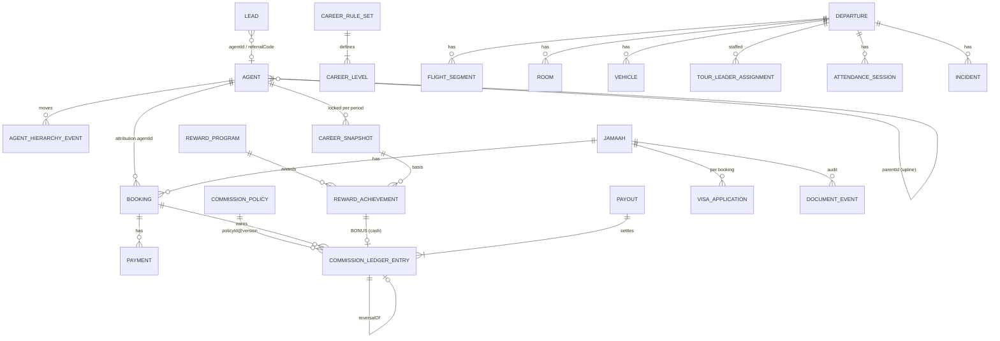

# Hasta Travel Workspace V2 — Data Contracts (M3.0)

> Proposed TypeScript contracts for V2. **Nothing here is implemented yet.** Existing types in `content/admin/types.ts`, `costing.ts`, `hajj.ts` and `inventory.ts` are reused and extended; new types are additive. All money is integer IDR (`number`, safe integer) at rest and `BigInt` in calculations, matching `financialBalance` and `costing.ts`. All dates are `YYYY-MM-DD` strings; event timestamps are ISO strings derived from the **demo clock** (see §11).

Related: [Audit](HASTA_V2_REPOSITORY_AUDIT.md) · [Role matrix](HASTA_V2_ROLE_MATRIX.md) · [Architecture](HASTA_V2_ARCHITECTURE.md) · [Roadmap](HASTA_V2_ROADMAP.md)

Conventions
- IDs are stable strings with a prefix (`AGT-`, `CL-`, `POL-`, `CME-`, `PAYOUT-`…), created via existing `uid(prefix)` or deterministic fixture IDs in the seed.
- No `null` in persisted data — use omitted optional fields or `""` (the `sameShape` guard treats `typeof null` as `"object"`).
- "Snapshot" fields copy values at the moment of a business event and are never recomputed.
- Append-only collections are protected like `assertInventoryHistory`: existing entries may not be removed or edited, except fields explicitly marked *monotonic*.

---

## 1. Session and access

```ts
// content/admin/roles.ts (new)
export const roleIds = ["SUPERADMIN", "OWNER", "SALES_CS", "FINANCE", "OPERATIONS", "AGENT", "TOUR_LEADER", "PILGRIM"] as const;
export type UserRole = typeof roleIds[number];

export type PermissionAction = "read" | "write" | "approve" | "execute" | "self";
export type Permission = `${string}:${PermissionAction}`;   // e.g. "pembayaran:execute", "komisi:approve"

export type RoleDefinition = {
  id: UserRole;
  label: string;                 // "Sales & Customer Service"
  description: string;           // one line for the gateway card
  shell: "admin" | "portal";
  home: string;                  // "/admin/dashboard" | "/portal/agen" …
  persona:                        // how the persona is chosen on the gateway
    | { kind: "staff"; defaultUserId: string }
    | { kind: "agent"; defaultAgentId: string }
    | { kind: "pilgrim"; defaultJamaahId: string }
    | { kind: "tourLeader"; defaultUserId: string };
  permissions: readonly Permission[];
  navigation: readonly string[]; // ordered nav slugs (admin) or portal tab ids
};

// Server-side, from the signed cookie. Never stored in DemoState.
export type DemoSession = {
  version: 2;
  role: UserRole;
  personaId: string;             // USR-*, AGT-*, JMH-*
  expires: number;               // epoch ms
  legacy?: true;                 // decoded from the old "hasta-demo-owner" token
};
```

Token format (M3.1): `hasta-demo.v2.<ROLE>.<personaId>.<expires>.<hmacHex>`; `personaId` matches `^[A-Z]{2,5}-[A-Za-z0-9-]{1,40}$`. Legacy `hasta-demo-owner.<expires>.<hmac>` decodes to `{ role: "SUPERADMIN", personaId: "USR-1", legacy: true }`.

**Reuse:** `Staff` stays the staff record. Add an optional `roleId?: UserRole` (keep `role: string` for the existing UI and shape compatibility). `DemoState.permissions` stays in state (shape compatibility) but becomes a read-only illustration; the code constant in `roles.ts` is the source of truth.

## 2. Agents, attribution and hierarchy

```ts
// Extends existing Agent (types.ts:35). Existing fields keep their meaning except `status`.
export type Agent = {
  id: string; name: string; phone: string; city: string;
  level: string;                 // LEGACY label kept for compatibility; mirrors CareerLevel.name
  commission: number;            // LEGACY flat rate; becomes optional per-agent override in policies
  status: "Menunggu" | "Disetujui" | "Dibayar"; // LEGACY agent-level commission flag — frozen, no longer written after M3.3
  // V2 additions (migration v3)
  code: string;                  // unique referral code, e.g. "HASTA-AH01"
  parentId: string;              // "" for root; single parent ⇒ forest, no cycles
  joinedAt: string;              // date
  accountStatus: "ACTIVE" | "SUSPENDED" | "INACTIVE";
  levelId: string;               // current CareerLevel.id (changes only via a locked CareerSnapshot or audited override)
  email?: string;
};

export type AttributionSource = "REFERRAL_CODE" | "LEAD" | "MANUAL" | "MIGRATED";
export type BookingAttribution = {
  agentId: string;               // "" = direct sale
  source: AttributionSource;
  code?: string;                 // referral code used
  attributedAt: string;          // date
  attributedBy: string;          // staff/persona id
  lockedAt?: string;             // set when the first payment is verified; changes after this need approval
  uplineSnapshot?: string[];     // ancestor agent ids at lock time, nearest first (used for overrides)
  levelSnapshot?: string;        // agent levelId at lock time
};

// Booking gains one optional field (optional ⇒ no sameShape break; migration still backfills it).
export type Booking = ExistingBooking & { attribution?: BookingAttribution };

// Lead gains attribution (M3.2) and CRM fields (M5.2).
export type Lead = ExistingLead & { agentId?: string; referralCode?: string };

// Append-only history of hierarchy moves (who, when, from, to, why).
export type AgentHierarchyEvent = {
  id: string; agentId: string; fromParentId: string; toParentId: string;
  effectiveDate: string; reason: string; actorId: string; createdAt: string;
};
```

Invariants
- `Agent.code` unique (case-insensitive); `parentId` references an existing agent or `""`; no cycles; configurable max depth (fixture 4).
- `Jamaah.agentId` remains the **default** agent for that person's future bookings; the **booking** attribution is the commercial source of truth.
- Attribution change after `lockedAt` requires `agen:approve` and produces commission reversals/re-earnings (M3.3), never edits.
- An agent may not be attributed to a booking whose jamaah phone equals the agent's phone (self-referral rule; configurable — decision).

## 3. Career levels and qualification

```ts
export type CareerMetric = "PERSONAL_PILGRIMS" | "PERSONAL_VALUE" | "TEAM_PILGRIMS" | "TEAM_VALUE" | "ACTIVE_DIRECTS";

export type CareerLevel = {
  id: string;                    // "CL-1"
  name: string;                  // fixtures reuse existing labels: "Agent", "Senior Agent", "Coordinator", + "Regional Coordinator"
  rank: number;                  // 1..n, unique
  requirements: { metric: CareerMetric; min: number }[]; // all must hold
  periodsRequired: number;       // consecutive qualifying periods, fixture 1
  active: boolean;
  description: string;
};

export type CareerRuleSet = {
  id: string; version: number; effectiveFrom: string;
  period: "MONTH" | "QUARTER";
  qualifyingEvent: "FIRST_PAYMENT_VERIFIED" | "FULLY_PAID" | "DEPARTED"; // what makes a booking count, and on which date
  teamDepth: number;             // levels of downline counted in TEAM_* metrics
  activeDirectWindowPeriods: number;
  demotion: "NEVER" | "AFTER_MISSED_PERIODS";
  missedPeriodsBeforeDemotion?: number;
  lateCancellation: "ADJUST_NEXT_PERIOD" | "IGNORE_LOCKED"; // cancellations affecting a locked period
  levels: CareerLevel[];
};

export type CareerMetrics = {
  personalPilgrims: number; personalValue: number;   // own attributed qualifying bookings
  teamPilgrims: number; teamValue: number;           // downline only (excludes personal) — group = personal + team
  activeDirects: number;
  adjustments: { bookingId: string; reason: string; pilgrims: number; value: number }[];
};

// CareerProgress = live (unlocked) computation; CareerSnapshot = locked history.
export type CareerProgress = {
  agentId: string; periodId: string;                 // "2026-10" | "2026-Q4"
  metrics: CareerMetrics;
  currentLevelId: string; qualifiesForLevelId: string;
  nextLevel?: { levelId: string; gaps: { metric: CareerMetric; current: number; required: number }[] };
};
export type CareerSnapshot = CareerProgress & {
  id: string; ruleSetId: string; ruleSetVersion: number;
  levelBeforeId: string; levelAfterId: string;
  bookingIds: string[];          // exact bookings counted (audit, prevents double counting)
  status: "LOCKED"; lockedAt: string; lockedBy: string;
};
```

Career data never contains money owed. The commission engine reads only `levelSnapshot` / `levelAfterId`.

## 4. Commission policies and ledger

```ts
export type CommissionBasis =
  | { kind: "FLAT_PER_PILGRIM"; amount: number }
  | { kind: "PERCENT_OF_CONTRACT"; basisPoints: number; cap?: number };   // 150 = 1.50 %

export type CommissionPolicy = {
  id: string; version: number; name: string;
  status: "DRAFT" | "ACTIVE" | "RETIRED";
  effectiveFrom: string; effectiveTo?: string;
  scope: { productTypes: ProductType[]; packageIds?: string[] };       // reuse ProductType
  trigger: "FIRST_PAYMENT_VERIFIED" | "FULLY_PAID" | "DEPARTED";
  personal: CommissionBasis;
  personalByLevel?: { levelId: string; basis: CommissionBasis }[];    // optional level-based rate
  useAgentFlatOverride: boolean;                                       // honour legacy Agent.commission
  overrides: { depth: number; basis: CommissionBasis; minLevelRank?: number }[]; // upline tiers; [] allowed
  holdDays: number;              // entry becomes payable N days after earning
  clawback: "NET_AGAINST_FUTURE" | "WRITE_OFF";
  notes: string;
};

export type CommissionEntryType = "PERSONAL" | "OVERRIDE" | "BONUS" | "REVERSAL" | "ADJUSTMENT";

export type CommissionLedgerEntry = {
  id: string;
  key: string;                   // idempotency key, UNIQUE — see below
  agentId: string;
  type: CommissionEntryType;
  amount: number;                // signed integer IDR; REVERSAL is the exact negative of its target
  bookingId?: string; rewardAchievementId?: string;
  reversalOf?: string;           // entry id
  policyId?: string; policyVersion?: number; tierDepth?: number;
  basisSnapshot: {               // frozen explanation, shown on statements
    contractAmount?: number; basis?: CommissionBasis; agentLevelId?: string; trigger?: string; triggerDate?: string;
  };
  earnedOn: string;              // business date the trigger happened
  payableFrom: string;           // earnedOn + holdDays
  reason: string;
  createdAt: string; createdBy: string;
  payoutId?: string;             // MONOTONIC: set once when included in a non-void payout; cleared only if that payout is voided
};
```

Idempotency keys
- `PERSONAL:<bookingId>:<policyId>@<version>`
- `OVERRIDE:<bookingId>:<policyId>@<version>:d<depth>`
- `BONUS:<rewardAchievementId>`
- `REVERSAL:<entryId>`
- `ADJUSTMENT:<uid>` (manual, requires reason + approver)

Derived entry state (never stored): `PENDING_HOLD` (today < payableFrom) → `PAYABLE` → `IN_PAYOUT` (payout DRAFT/APPROVED) → `PAID` (payout PAID); reversed entries show `REVERSED`.

## 5. Rewards and payouts

```ts
export type RewardProgram = {
  id: string; name: string; status: "DRAFT" | "ACTIVE" | "CLOSED";
  period: "MONTH" | "QUARTER" | "YEAR"; periodId: string;           // programme window
  metric: CareerMetric; threshold: number;
  eligibleLevelIds?: string[];
  reward: { kind: "CASH"; amount: number } | { kind: "NON_CASH"; description: string; estimatedValue: number };
  oncePerAgent: true;
  basedOn: "LOCKED_SNAPSHOT";    // rewards are computed only from locked career snapshots
  notes: string;
};
export type RewardAchievement = {
  id: string; programId: string; agentId: string; periodId: string; snapshotId: string;
  value: number;                 // metric value at evaluation
  status: "ELIGIBLE" | "APPROVED" | "FULFILLED" | "VOID";
  approvedBy?: string; approvedAt?: string; fulfilledAt?: string; voidReason?: string;
  // CASH → creates one BONUS ledger entry on approval. NON_CASH → fulfilment tracked here only.
};

export type Payout = {
  id: string; agentId: string;
  periodLabel: string;           // display, e.g. "Oktober 2026"
  entryIds: string[];            // PERSONAL/OVERRIDE/BONUS/ADJUSTMENT + REVERSAL entries netted in
  gross: number;                 // sum of positive entries
  deductions: number;            // sum of negative entries (≤ 0)
  net: number;                   // gross + deductions, must be > 0
  status: "DRAFT" | "APPROVED" | "PAID" | "VOID";
  preparedBy: string; preparedAt: string;
  approvedBy?: string; approvedAt?: string;
  paidBy?: string; paidAt?: string; reference?: string; // simulated transfer reference
  voidReason?: string;
};
```

Payout invariants
- An entry belongs to at most one payout whose status ≠ `VOID`.
- `net = Σ amount(entryIds)`, recomputed and checked on decode.
- `PAID` payouts are immutable (append-only guard). `APPROVED` may be voided by `komisi:approve` holders; `DRAFT` is freely editable by Finance.
- If eligible negatives exceed positives, the batch is not created; the deficit carries forward (`NET_AGAINST_FUTURE`) or is written off by an approved `ADJUSTMENT`.

## 6. Departures, flights and manifest

```ts
// Departure (types.ts:9) is kept; additions are optional and backfilled by migration.
export type Departure = ExistingDeparture & {
  flightSegments?: FlightSegment[];
  hotels?: { city: "Makkah" | "Madinah"; name: string; checkIn: string; checkOut: string }[]; // snapshot from package
};
export type FlightSegment = {
  id: string; direction: "OUTBOUND" | "RETURN" | "DOMESTIC";
  airline: string; flightNo: string; from: string; to: string;
  date: string; etdLocal: string; etaLocal: string; pnr: string; terminal?: string;
};

// Manifest stays DERIVED (no stored manifest). The contract is the row shape used by UI, print and export.
export type ManifestRow = {
  no: number; jamaahId: string; name: string; gender: Jamaah["gender"]; birthDate: string;
  passport: string; passportExpiry: string; visaStatus: VisaStatus;
  roomMakkah: string; roomMadinah: string; vehicle: string;
  ready: boolean; blockers: string[];
};
```

Migration: `Departure.airline/flight/origin/pnr` become segment 0 (`OUTBOUND`, `from: origin`, `to: "JED"`, times empty = "Belum dijadwalkan"); legacy fields remain and are kept in sync for existing screens until removed.

## 7. Documents and visa

```ts
// Jamaah.documents (status map) stays the current-status source for compatibility.
export type PilgrimDocument = {
  id: string; jamaahId: string; type: string;   // key in Jamaah.documents
  status: DocumentStatus;                        // reuse
  fileMeta?: { name: string; sizeKb: number; mime: string }; // metadata only; file never stored
  number?: string; expiryDate?: string;
  rejectionReason?: string;
  version: number;                               // increments per upload
};
export type DocumentEvent = {                    // append-only audit
  id: string; jamaahId: string; type: string;
  action: "UPLOADED" | "VERIFIED" | "REJECTED" | "REQUESTED" | "EXPIRED_FLAG";
  actorId: string; at: string; note: string;
};
export type DocumentRequirement = {             // per product/profile instead of fixed 8 docs
  id: string; documentType: string; productTypes: ProductType[];
  appliesTo: "ALL" | "MARRIED" | "UNDER_18";      // demo rule set only; real requirements must come from the client/regulator
  requiredDaysBeforeDeparture: number; mandatoryForManifest: boolean;
};

export type VisaApplication = {
  id: string; jamaahId: string; bookingId: string; departureId: string;
  status: VisaStatus;                            // reuse union
  number: string; submittedAt: string; approvedAt: string; expiry: string; notes: string;
  history: { status: VisaStatus; at: string; actorId: string; note: string }[];
};
```

Migration (v6, M4.1): one `VisaApplication` per jamaah with an active **Umrah** booking from the existing `Jamaah.visa*` fields; `Jamaah.visa*` kept as a mirror of the latest application so `readiness`, `manifestReady`, filters and tests keep working. `DocumentRequirement` fixture reproduces today's 8-document list for `UMRAH` so `documentPercent` results do not change until the rules are edited.

## 8. Rooming and transport

```ts
// Room (types.ts:36) stays as the allocation record (Room.jamaahIds). Optional additions:
export type Room = ExistingRoom & { hotelName?: string; roomType?: "Quad" | "Triple" | "Double" };
export type RoomAllocation = { roomId: string; jamaahId: string };   // DERIVED view over Room.jamaahIds (no new storage)

export type Vehicle = {
  id: string; departureId: string; label: string;      // "Bus 01"
  capacity: number; segment: string;                   // "JED → Madinah"
  driverName: string; driverPhone: string;             // demo values
  jamaahIds: string[];                                 // allocation, same pattern as Room
};
export type TransportAllocation = { vehicleId: string; jamaahId: string }; // DERIVED view
```

Invariants: member of the departure; one vehicle per jamaah per departure; `jamaahIds.length ≤ capacity`; room warning when `booking.roomType` capacity ≠ room capacity (warning, not error — families mix). Migration (v7, M4.2): `Jamaah.bus` values become per-departure `Vehicle`s (capacity 45, as today) and `jamaahIds`; `Jamaah.bus` stays as a mirror until removal.

## 9. Tour leader, attendance, incidents

```ts
export type TourLeaderAssignment = {
  id: string; departureId: string; userId: string;     // Staff.id with roleId TOUR_LEADER
  role: "TOUR_LEADER" | "MUTHAWWIF" | "ASSISTANT";
  assignedAt: string; assignedBy: string; status: "ACTIVE" | "REPLACED";
};

export type AttendanceSession = {
  id: string; departureId: string;
  kind: "MANASIK" | "AIRPORT_CHECKIN" | "BUS_BOARDING" | "ITINERARY" | "HOTEL_CHECKIN";
  refId?: string;                // Manasik.id or itinerary day
  title: string; scheduledAt: string; takenBy: string; takenAt?: string;
  records: { jamaahId: string; status: "PRESENT" | "ABSENT" | "EXCUSED"; note: string; at: string }[];
};

export type Incident = {
  id: string; departureId: string; reportedBy: string; reportedAt: string;
  category: "HEALTH" | "LOST_ITEM" | "DOCUMENT" | "DELAY" | "ACCOMMODATION" | "OTHER";
  severity: "LOW" | "MEDIUM" | "HIGH";
  jamaahIds: string[]; title: string; description: string;
  status: "OPEN" | "IN_PROGRESS" | "RESOLVED";
  updates: { at: string; actorId: string; note: string; status: Incident["status"] }[]; // append-only
};
```

`Manasik.attendees` stays the source for manasik attendance (used by `readiness`); an `AttendanceSession` of kind `MANASIK` writes through to `Manasik.attendees` so there is one truth.

## 10. CRM and executive read models

```ts
// M5.2 additions to Lead (optional fields)
export type LeadExtension = {
  ownerUserId?: string;          // replaces free-text `sales` (kept as display mirror)
  followUps?: { id: string; dueDate: string; channel: "WhatsApp" | "Telepon" | "Kunjungan" | "Email"; outcome: string; doneAt?: string; actorId: string }[];
  lostReason?: string;
  createdAt?: string;
};

// Executive read models are DERIVED (pure selectors), never stored.
export type DepartureProfitability = {
  targetId: string; productType: ProductType;
  revenue: number; collected: number; outstanding: number;
  hppFinal?: number; actualExpenses: number; plannedCommission?: number; accruedCommission: number;
  grossMarginActual: number; grossMarginPlanned?: number;
};
export type ReceivableAging = { bookingId: string; jamaahId: string; outstanding: number; bucket: "NOT_DUE" | "0_30" | "31_60" | "61_90" | "90_PLUS"; due: string };
export type OperationalRisk = { departureId: string; ruleId: string; severity: "INFO" | "WARNING" | "BLOCKER"; count: number; message: string; href: string };
```

## 11. DemoState additions and storage versions

| Version | Milestone | New top-level keys | Field additions | Migration actions |
|---|---|---|---|---|
| 2 (current) | M2 | — | — | — |
| 3 | M3.1 | — | `Staff.roleId?`; seed users `USR-4..6` | Add missing persona users (only if IDs unused); map existing users to `roleId` |
| 4 | M3.2 | `careerRuleSets`, `careerSnapshots`, `agentHierarchyEvents` | `Agent.code/parentId/joinedAt/accountStatus/levelId`; `Booking.attribution?`; `Lead.agentId?` | Generate codes; `parentId=""` (or fixture tree only on fresh seed — decision); `levelId` from legacy `level` label; backfill `booking.attribution` from `jamaah.agentId` with `source:"MIGRATED"`, `lockedAt` = first verified payment date |
| 5 | M3.3 | `commissionPolicies`, `commissionLedger`, `rewardPrograms`, `rewardAchievements`, `payouts` | — | Create fixture policy reproducing the legacy flat rate per agent; **no automatic historical payouts**: legacy `Agent.status = "Dibayar"` becomes one opening `ADJUSTMENT`+`Payout(PAID)` per agent only if decision D4 says so, otherwise ignored and labelled |
| 6 | M4.1 | `documentEvents`, `documentRequirements`, `visaApplications` | `Departure.flightSegments?`, `hotels?` | as §6/§7 |
| 7 | M4.2 | `tourLeaderAssignments`, `attendanceSessions`, `incidents`, `vehicles` | `Room.hotelName?/roomType?` | as §8; TL assignment fixture for the TL persona |
| 8 | M5.2 | — | Lead extensions | `ownerUserId` from `sales` name match |

Every migration is a pure function `(state) => void` registered in `lib/admin/migrations.ts`, executed in order **before** `sameShape`, deterministic and idempotent, and covered by a saved-fixture test (pattern: `tests/m2.spec.ts` v1→v2). The storage key stays `hasta-workspace-m1.1` (changing it would silently orphan saved demos); only `version` increases.

**Demo clock:** introduce `demoNow()` (date = `DEMO_TODAY`, time = real time-of-day) and use it for new timestamps (`verifiedAt`, ledger `createdAt`, snapshots). Existing records are not rewritten.

## 12. Relationships



## 13. Demo fixtures (configurable, not client policy)

All values are illustrative and labelled "Contoh konfigurasi demo — sesuaikan dengan kebijakan travel" in the UI.

| Fixture | Value |
|---|---|
| Career levels | `CL-1 Agent` (rank 1, no requirement) · `CL-2 Senior Agent` (≥ 5 personal pilgrims/quarter) · `CL-3 Coordinator` (≥ 8 personal + ≥ 15 team pilgrims + ≥ 2 active directs) · `CL-4 Regional Coordinator` (≥ 10 personal + ≥ 40 team + ≥ 4 active directs) |
| Rule set | period `QUARTER`, qualifying event `FULLY_PAID`, team depth 3, demotion `NEVER`, late cancellation `ADJUST_NEXT_PERIOD` |
| Umrah policy | trigger `FULLY_PAID`; personal flat Rp 1.000.000 (= today's seed rate) with `useAgentFlatOverride: true`; overrides depth 1 Rp 250.000, depth 2 Rp 100.000 (min rank 3); hold 0 days; clawback `NET_AGAINST_FUTURE` |
| Hajj policy | trigger `FIRST_PAYMENT_VERIFIED`; personal 100 bps (1,00 %) of contract, optional cap; no overrides |
| Reward programmes | "Bonus 10 jamaah lunas / kuartal" cash Rp 2.500.000 · "Apresiasi 40 jamaah tim / tahun" non-cash (1 kursi Umrah, nilai estimasi from package price) |
| Hierarchy | 10 existing agents arranged as 2 roots, depth ≤ 3 (fresh seed only) |
