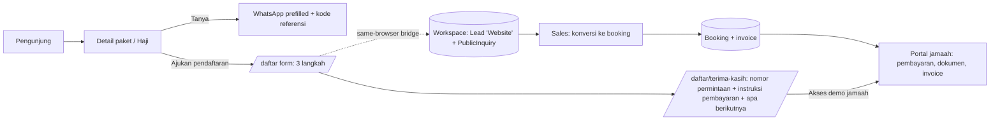

# Hasta Travel V2 — Public User Journeys & Integration (M3.0-B)

> The journeys were traced on the live demo (https://hasta-travel.demo.kalsara.id) and against the source, 2026-11-07. No analytics exist, so no conversion or drop-off rates are claimed. "Drop-off risk" means a qualitative risk based on the observed friction.

Related: [Audit](HASTA_V2_PUBLIC_AUDIT.md) · [Sitemap](HASTA_V2_PUBLIC_SITEMAP.md) · [Copy](HASTA_V2_PUBLIC_COPY_AUDIT.md) · [Refinement plan](HASTA_V2_PUBLIC_REFINEMENT_PLAN.md) · Workspace: [Role matrix](HASTA_V2_ROLE_MATRIX.md), [Data contracts](HASTA_V2_DATA_CONTRACTS.md)

---

## Journey A — Umrah package discovery

**Actual steps**

| # | Desktop | Mobile (390 px) |
|---|---|---|
| 1 | `/` → hero "Lihat paket" (or a featured card) | Same; hero CTAs are full-width and visible above the fold |
| 2 | `/paket-umroh`: filters visible; 18 cards in a 3-column grid | Filters collapsed behind "Filter"; cards stacked (≈ 8,100 px page) |
| 3 | Card → `/paket-umroh/<slug>?d=<nearest matching date>` | Same |
| 4 | Date chips → price table and availability update; URL `?d=` updates | Same; a sticky bottom bar shows date + quad price |
| 5 | "Tanya paket ini via WhatsApp" opens `wa.me` with package, date and city prefilled | "Tanya paket ini" in the sticky bar |

**Friction and findings**
- Correct destinations. The card link carries the filtered date to the detail page (`PackageCard.tsx`), and the detail page restores it.
- **Missing information before step 5:** DP amount, payment deadline, cancellation terms. These exist only as "contoh ketentuan" in the FAQ. No departure city filter. Madinah distance only on the detail page.
- **Redundant/long:** itinerary fully expanded; FAQ repeated on the homepage and the detail page.
- **Sold-out:** a sold-out date is selectable and the CTA stays "Tanya paket ini". There is no waitlist or alternative-date suggestion.
- **Navigation:** on mobile, "Jadwal" (an alternative discovery path) is off-screen in the header nav.
- **Drop-off risks:** the only next step is a WhatsApp handoff (leaves the site); no way to save, compare or share a shortlist.

## Journey B — Haji Khusus discovery

**Actual steps**

1. `/`: Haji Khusus appears only in the eyebrow label and the header nav. There is no homepage section or CTA.
2. Header → `/haji-khusus`. On mobile the "Haji Khusus" nav item is visible; others may be clipped.
3. Three long cards. "Lihat fasilitas dan syarat pendaftaran" expands details inline.
4. "Tanya masa tunggu & pembayaran" opens WhatsApp.

**Friction**
- No detail page per product (`hajiBySlug` is unused), so a product can't be shared.
- No process explanation (porsi, setoran, pelunasan, manasik).
- No eligibility checklist.
- **Mujamalah/Furoda listed under Haji Khusus**, and its WhatsApp message asks about "masa tunggu" for a no-queue product.
- Prices are in USD only, with no IDR guidance range.
- No consultation form for the longer conversation Haji requires.
- **Drop-off risk:** high information needs are met with long cards and a single generic chat.

## Journey C — WhatsApp consultation

| Entry | `data-wa-source` | Message context | Visible on mobile? |
|---|---|---|---|
| Header button | `header` | generic | **No** (`md:inline-flex`) |
| Hero / closing CTA | `hero`, `cta-akhir` | generic | Yes (home only) |
| Detail price block | `detail` | package + date + city | Yes |
| Detail sticky bar | `sticky-mobile` | package + date + city | Yes (mobile only) |
| Haji cards | `haji` | package (+ the bug noted in the Copy doc §7) | Yes |
| FAQ / Kontak routes | `faq`, `kontak-*` | generic / Haji / Badal | Yes |
| Footer studio CTA | `footer-studio` | **Studio sales** | Yes, on every page |

**Findings**
- Contextual messages on the detail page are a strength (verified: the date change updates the text).
- On mobile `/paket-umroh`, `/jadwal-keberangkatan` and `/tentang`, the only visible WhatsApp button is the **studio** CTA.
- `data-wa-source` attributes exist, but no analytics consumes them.
- All operator CTAs go to the studio's real number with the demo footer line (intentional for a portfolio).
- Generic messages give the operator nothing to act on (no month, party size or city).
- Opening WhatsApp leaves the site and there is no record in the workspace CRM, so the "Leads website" screen stays empty in the demo.

## Journey D — Registration

**Status: does not exist.**
- No booking form, confirmation page or payment-instruction page.
- `/booking`, `/daftar` and similar paths return the default English 404.
- The only "registration" is a WhatsApp conversation. Payment instructions appear only as the static bank account inside the trust section (Kontak, Tentang, Haji pages).

Implications:
- Form validation, error recovery, confirmation and payment instruction cannot be audited because none exist.
- The workspace already supports what this journey needs downstream: lead → booking conversion, installments, invoice/receipt PDFs, and verification by Finance.

## Journey E — Returning customer

**Status: does not exist.**
- No booking lookup, no pilgrim login, no payment history, no invoice download on the public site.
- Pilgrims receive invoices only if staff send the PDFs generated in the workspace.
- The V2 workspace plan adds a Pilgrim portal (`/portal/jamaah`, roadmap M5.1) that reuses `PaymentHistory`, `FinancialDocuments` and `HandoverReceipt`.

## 6. Proposed cohesive journey and data contract

### 6.1 Target journey (demo)



Principles:
- **No second booking system.** A public submission creates a *request*, not a booking. Sales converts it with the existing `convertLead` (extended in roadmap M3.2 for attribution). Payments are recorded and verified only in the workspace.
- **One catalogue.** Public pages and the workspace must refer to the same package and departure IDs.
- **Honest demo bridge.** The public site and the workspace share data only inside the same browser (`localStorage`). The confirmation page says so: "Pada situs demo, permintaan ini tersimpan di browser Anda dan dapat dilihat melalui akses demo Sales." A production version needs the backend in `docs/FUTURE_BACKEND.md`.

### 6.2 Data contract (proposal; extends the workspace contracts)

```ts
// Written by the public site via a workspace domain function, never by direct JSON edits.
export type PublicInquiry = {
  id: string;                         // "WEB-xxxxxxxx"
  kind: "UMRAH_REGISTRATION" | "UMRAH_QUESTION" | "HAJJ_CONSULTATION" | "AGENT_APPLICATION";
  createdAt: string;                  // demo clock
  packageId?: string;                 // public package id (p01…) == workspace AdminPackage.id
  departureRef?: string;              // public departure id "<slug>-<date>"
  departureId?: string;               // workspace departure id when one exists for that date
  hajjPackageId?: string;
  roomType?: "Quad" | "Triple" | "Double";
  partySize: number;                  // 1–10
  contact: { name: string; phone: string; city: string; email?: string };
  pilgrims?: { name: string; gender: "Laki-laki" | "Perempuan"; ageGroup: "<18" | "18-59" | "60+" }[];
  needs?: string[];                   // "Kursi roda", "Pendamping lansia", …
  referralCode?: string;              // from ?ref= (sessionStorage), validated against Agent.code
  consent: { contact: true; at: string };
  source: { page: string; waSource?: string; utm?: Record<string, string> };
  status: "NEW" | "CONVERTED" | "CLOSED";
  leadId: string;                     // created atomically with a workspace Lead (source "Website")
};
```

Mapping rules:
- `createPublicInquiry(state, input)` validates the input, creates a `Lead` (`source: "Website"`, `packageId`, `agentId` from a valid referral code, `notes` = summary) and the `PublicInquiry` inside one `transact`.
- The public departure ID resolves to the workspace `Departure` with the same package and date. If none exists, the lead keeps `departureRef` and Sales chooses or creates a departure (the existing conversion UI already asks for one).
- Prices shown on the confirmation page are **estimates** copied from the public catalogue; the contract price is set when Sales converts (existing `addBooking` snapshot).
- Duplicate protection: the same phone + package + departure within 24 h updates the existing inquiry instead of creating a new one.
- Storage: adds `publicInquiries` to `DemoState` through the migration pipeline described in Data Contracts §11 (a new version after M3.2).

### 6.3 Catalogue unification (prerequisite)

| Today | Target |
|---|---|
| Public departures (47, `seatsAvailable` fixtures) ≠ workspace departures (8, capacity-based) | Workspace seed derives **all** public departures (ID `"<slug>-<date>"` kept as `publicRef`). Seats shown publicly = `capacity − active bookings` in the demo browser; with no workspace data, fall back to the fixture value. |
| Public Haji (`content/haji.ts`) ≠ workspace Hajj (`content/admin/hajj.ts`) | One Hajj catalogue; the workspace `HajjPackage` gains the public display fields (waiting years, hotels, quota note) or the public file becomes the seed source |
| Bank details in `company.ts` and `settings` | Public trust section reads the same source as invoices (the workspace settings seed is initialised from `company.ts` already) |
| Hard-coded testimonial | The workspace CMS testimonial with status "Terbit" (labelled demo) |

Static rendering stays the default. Workspace-aware values (live seats, inquiry status) render client-side only when demo data exists in the browser, so SEO HTML and the no-data case keep the static fixtures.

## 7. Agent and referral entry points

### 7.1 Visitor types

| Visitor | Today | Needed |
|---|---|---|
| Prospective agent ("ingin menjadi mitra") | Nothing; the only agent mention is the warning "termasuk yang mengaku agen kami" | Programme introduction, application request, FAQ, demo access to the agent portal |
| Agent-referred pilgrim (opens a link from an agent) | `?ref=` ignored | Code captured, shown discreetly ("Anda dibantu oleh mitra: {nama}"), carried into WhatsApp text and registration |
| Existing agent | Nothing on the public site | "Masuk → Mitra" leading to the demo gateway with the Agent role (workspace M3.1) |

### 7.2 Proposed entry points

1. **`/mitra` page — "Menjadi Mitra Hasta"**
   - **Objective:** explain the partner programme without income promises.
   - **Sections:**
     1. What a partner does (introduce pilgrims, help with documents, never collect money personally).
     2. How attribution works (personal code and link).
     3. Partner obligations and code of conduct (payments only to the company account; no promises of departure or visa).
     4. How applications are reviewed.
     5. FAQ.
     6. Application form (demo; creates a `PublicInquiry` of kind `AGENT_APPLICATION`).
     7. "Lihat demo portal mitra" → gateway with the Agent role.
   - **Not shown:** commission rates, income examples, recruitment rewards, level names. The page says "Ketentuan imbal jasa dijelaskan dalam perjanjian kemitraan." This is consistent with workspace decision D6 (legal review of multi-level structures).
2. **Referral links:** `https://…/paket-umroh/<slug>?ref=<CODE>` (and on any public page).
   - The code is stored in `sessionStorage` for the visit.
   - It is validated client-side against workspace agents when demo data exists; otherwise it is kept as typed.
   - It is appended to WhatsApp messages ("Kode referensi: CODE") and prefilled in the registration form.
   - A visible "Hapus kode" lets the visitor remove it.
3. **Header "Masuk"** (V2, after the portals exist) with Jamaah and Mitra, both linking to the demo gateway with a preselected role, clearly labelled demo access. Competitor JMI exposes a similar login split (Jamaah / Agen / Admin).
4. **Agent FAQ** (on `/mitra` and as an FAQ topic):
   - Siapa yang bisa menjadi mitra?
   - Apakah mitra boleh menerima pembayaran jamaah? (No.)
   - Bagaimana jamaah tahu mitra itu resmi?
   - Apa yang terjadi bila jamaah batal?
   - Bagaimana data jamaah dilindungi?

Integration dependencies: `Agent.code` and booking attribution (workspace M3.2), the agent portal (M3.2/M3.3), and `PublicInquiry` (this plan).

## 8. Journey-level recommendations (summary)

| Journey | Key change | Depends on |
|---|---|---|
| A | Payment-terms block on detail, departure city filter, collapsed itinerary, sold-out waitlist wording, "Ajukan pendaftaran" | Copy approval; registration form |
| B | Haji process timeline, Haji detail pages, separated Mujamalah, Haji consultation form | Client verification of Haji facts; Hajj catalogue unification |
| C | Mobile menu with operator WhatsApp, persistent mobile CTA, structured prefill, referral code in text, studio CTA separated | — |
| D | `/daftar` (3 steps: paket & tanggal → jamaah & kontak → tinjau) → `/daftar/terima-kasih` with request number, payment instructions (company account only), next steps | `PublicInquiry`, workspace migration |
| E | "Cek pendaftaran" linking to the Pilgrim portal demo; the confirmation page links there | Workspace M3.1 gateway, M5.1 portal |
